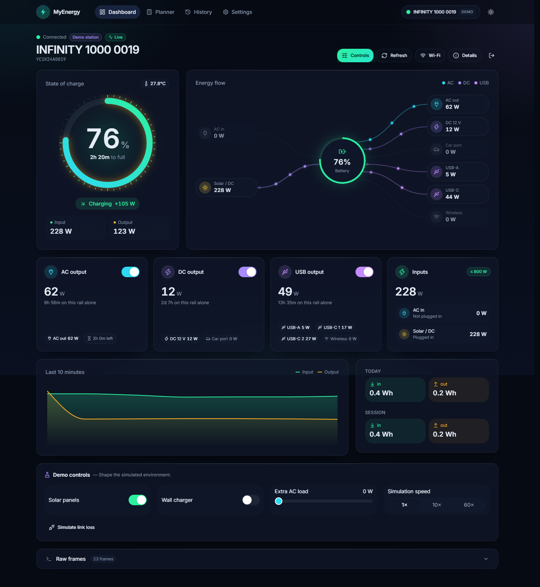
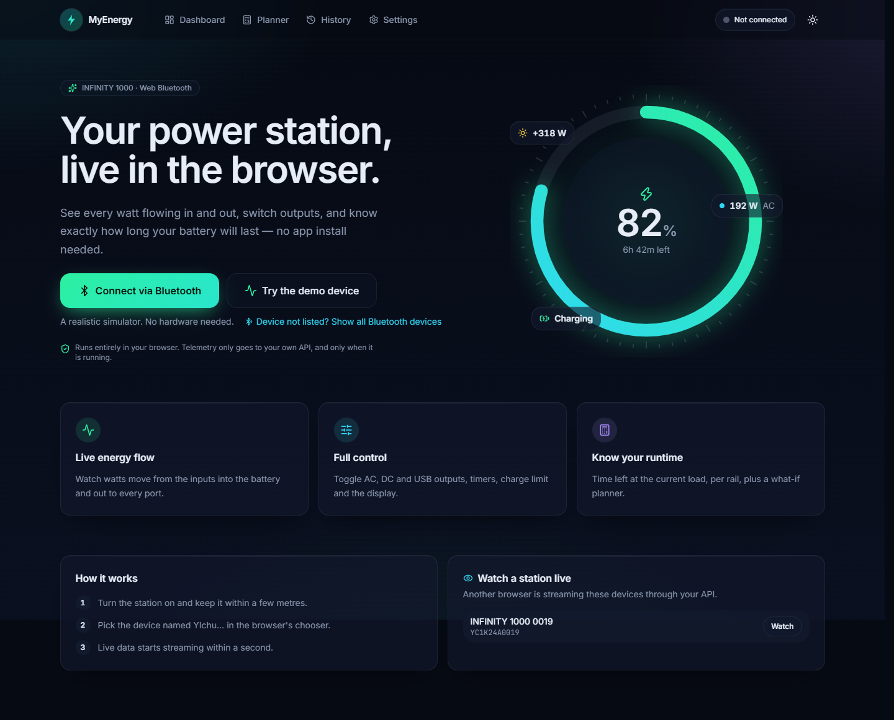
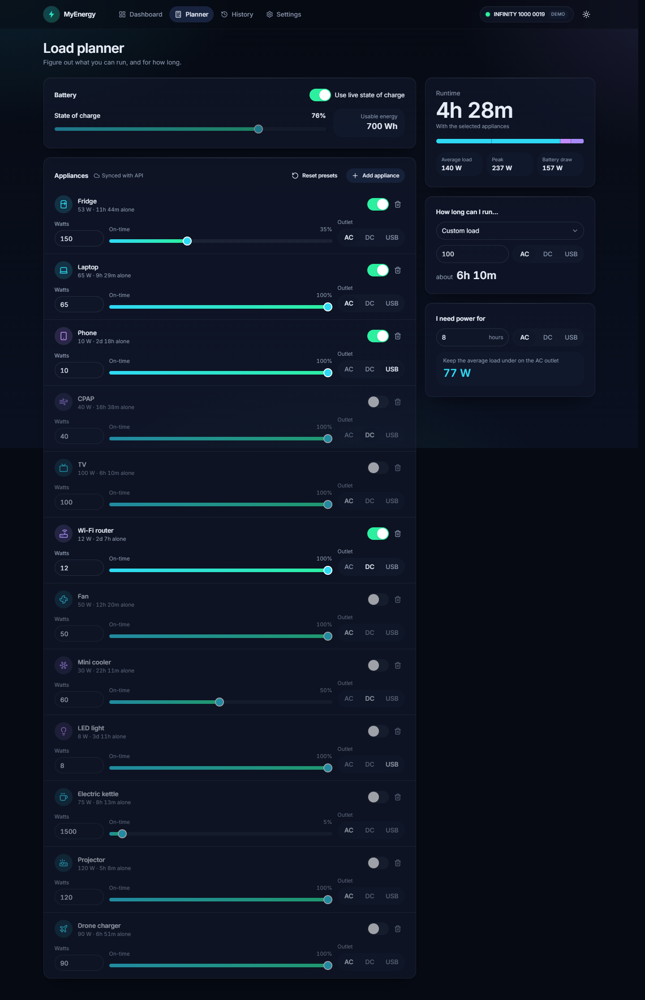
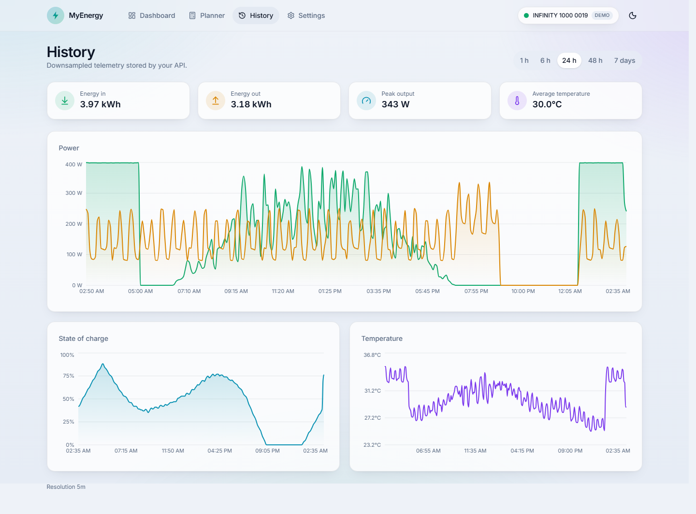
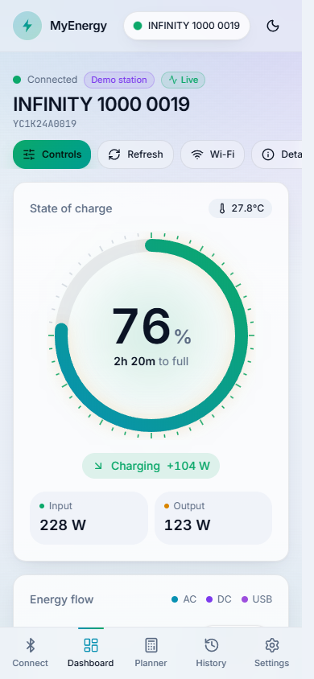
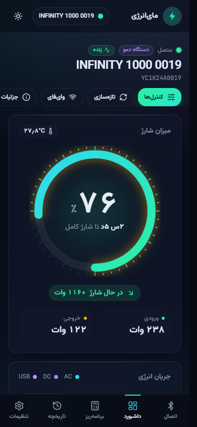
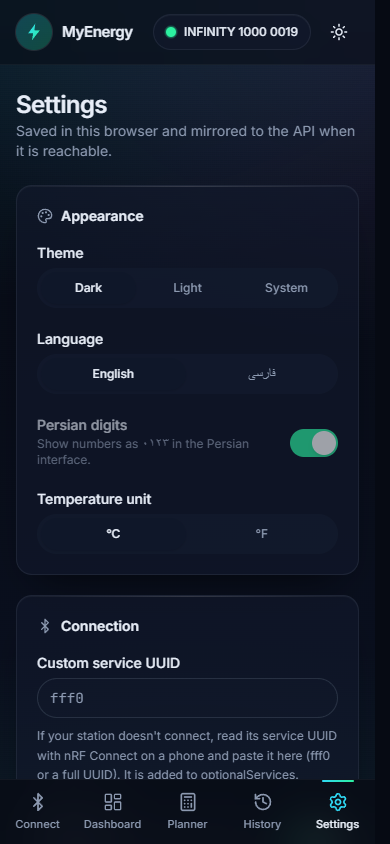

# MyEnergy Dashboard

**An unofficial, open-source dashboard for the INFINITY 1000 portable power station that runs in the browser.** The browser talks to the station directly over **Web Bluetooth**; no vendor app or cloud account is needed. You get live power per port, state of charge, battery health and temperature, control of every output and setting, and an honest estimate of how long the battery will last at the current load.

     



> Tested on a real station (model code `MGI032GR1HEU`, BLE name `YIchu…`, sold as *INFINITY 1000*), the device used by the *MyEnergy Power* Android app. A built-in simulator speaks the same bytes, so everything also works without hardware.

## Highlights

- 🔌 **Direct Bluetooth from the browser.** Chrome / Edge on desktop and Chrome on Android, with no app store and no cloud.
- ⚡ **Live energy flow.** Animated diagram whose particle speed scales with watts, plus AC/DC/USB/USB-C/car/wireless rails.
- 🔋 **Battery insight.**
  - SOC, health, current, cell voltage and internal temperatures. Some of these were decoded from frames the official app ignores.
  - Runtime and time-to-full, calibrated against measurements on the real device.
- 🎛️ **Full control.**
  - AC/DC/USB outputs (optimistic, confirmed by the device).
  - Timers, charge-power limit, light, backlight, silent / constant-power modes.
  - Wi-Fi provisioning.
- 🧮 **Load planner.** "What can I run, and for how long?" with duty cycles, plus the reverse calculator.
- 📈 **History.** NestJS + SQLite stores downsampled telemetry; Socket.IO lets a second browser or phone watch live.
- 🌍 **English and Persian.** Full RTL layout, Vazirmatn font, Persian digits; dark and light themes; accessible; reduced-motion aware.
- 📲 **Installable app (PWA).** Runs from the Start menu in its own window and opens even when the server is off.
- 🧪 **Tested.**
  - Vitest for the protocol, including frames captured from a real device.
  - Jest for the API.
  - Playwright for the UI.

## Screenshots

| Connect | Planner | History |
| --- | --- | --- |
|  |  |  |

| Phone (light) | Phone (Persian, RTL) | Settings (phone) |
| --- | --- | --- |
|  |  |  |

More in [`docs/screenshots`](docs/screenshots): every page at desktop and phone width, in dark and light.

## Quick start

```bash
git clone https://github.com/fariborz0015/myenergy-dashboard.git
cd myenergy-dashboard
pnpm install
pnpm dev
```

- Open http://localhost:3000.
- Click **Try the demo device** to explore without hardware, or **Connect via Bluetooth** to use a real station.

## What's inside

```
packages/protocol   Dependency-free TS: frame builder, Modbus CRC, decoders, simulator, energy math (browser + Node)
apps/web            Next.js 15 · React 19 · Tailwind v4 · shadcn/ui · framer-motion · Zustand · Recharts · next-intl
apps/api            NestJS 11 · Prisma + SQLite · REST + Socket.IO (/live) · Swagger at /docs
```

- **Connect** (`/`): connect over Bluetooth, start the demo device, or watch a station that another browser is streaming. It detects whether the browser supports Web Bluetooth and explains what to do if it doesn't.
- **Dashboard** (`/dashboard`):
  - SOC ring with the runtime estimate (or time to full), next to the station's own estimate.
  - Animated energy-flow diagram; particle speed scales with watts.
  - AC/DC/USB cards with optimistic switches.
  - 10-minute sparkline and Wh counters for today and this session.
  - Controls sheet: charge limit, timers, light, backlight, modes.
  - Wi-Fi setup, connection details (GATT table, firmware), demo controls, and a raw frame console.
- **Planner** (`/planner`): what-if load planner with duty cycles, "how long can I run X", and the reverse "I need N hours → max load".
- **History** (`/history`): telemetry downsampled by the API, with energy totals. If the API is down it falls back to the current session's data.
- **Settings** (`/settings`): capacity and efficiencies, alert thresholds, custom service UUID, API sync, theme, language (English / فارسی with RTL and Persian digits), and °C/°F.

The web app works fully on its own with the demo device. The API is optional.

## Requirements

- Node ≥ 20.12 (developed on Node 22), pnpm 10 (`corepack enable`)
- For a real device: a browser with Web Bluetooth (see below)

## Development

```bash
pnpm install
pnpm dev            # web on http://localhost:3000, API on http://localhost:4000 (Swagger: /docs)
```

`pnpm dev` builds the protocol package first. On first run it also creates `apps/api/.env` from `.env.example` and the SQLite database (`apps/api/prisma/dev.db`).

To get sample history for the History page (48 h for the demo station):

```bash
pnpm --filter @myenergy/api build
pnpm --filter @myenergy/api seed:demo
```

Quality gates, all run from the root:

```bash
pnpm build          # protocol (tsup), api (nest), web (next)
pnpm test           # Vitest (protocol + web) and Jest (api unit + e2e on a throwaway SQLite DB)
pnpm lint
pnpm test:e2e       # Playwright smoke test (desktop + phone) against a production build; uses local Chrome
```

`test:e2e` uses the installed Google Chrome by default. Set `PW_CHANNEL=` (empty) and run `pnpm --filter @myenergy/web exec playwright install chromium` to use Playwright's own Chromium. `SCREENSHOTS=1 pnpm --filter @myenergy/web exec playwright test screenshots --project=desktop` regenerates `docs/screenshots` (start the API first so History has data).

Environment variables: `apps/web/.env.example` (`NEXT_PUBLIC_API_URL`) and `apps/api/.env.example` (`DATABASE_URL`, `PORT`, `WEB_ORIGIN`, `TELEMETRY_STORE_BUCKET_S`).

## Install as an app (Windows / Android / ChromeOS)

The dashboard is a PWA. Once installed it opens from the Start menu or desktop in its own window, like any Chrome app.

```bash
pnpm app:build                 # production build into apps/web/.next-app
pnpm --filter @myenergy/api build
```

Start the app server (port **3210**) and the API (port 4000) in the background. This is safe to run repeatedly:

```powershell
powershell -ExecutionPolicy Bypass -File scripts\start-myenergy.ps1
```

Then open `http://localhost:3210` in Chrome or Edge and click **Install app** in the header (or the install icon in the address bar).

**Start automatically with PM2 (recommended).** If PM2 already resurrects your processes at logon, register both servers once:

```bash
pm2 start ecosystem.config.cjs   # myenergy-app (3210) + myenergy-api (4000)
pm2 save                         # include them in `pm2 resurrect` at logon
```

To update after changing code, run `pnpm app:build && pm2 restart myenergy-app`. For the API, run `pnpm --filter @myenergy/api build && pm2 restart myenergy-api`. Stop the API with `pm2 stop myenergy-api` before running `pnpm dev`, because both use port 4000.

The service worker caches every page and its JS on the first visit, so the installed app **opens and works even when the app server isn't running**. That covers Bluetooth, the demo station, the planner and settings. Only History, live watching and cloud sync need the API.

The installed app is a different origin (`localhost:3210`) from `pnpm dev` (`localhost:3000`). Its settings, and the Bluetooth device you pick, are therefore separate.

## Browser support for Web Bluetooth

| Platform | Works? |
| --- | --- |
| Chrome / Edge on Windows, macOS, ChromeOS | ✅ |
| Chrome on Android | ✅ (the best target: the UI is phone-first) |
| Chrome on Linux | ✅ (you may need `chrome://flags/#enable-experimental-web-platform-features`) |
| Safari (macOS / iOS), Firefox | ❌ No Web Bluetooth. On iPhone/iPad use the **Bluefy** browser |

The page must be served from **`https://` or `http://localhost`**, which Web Bluetooth requires. To use a phone during development, either:
- tunnel the dev server over HTTPS, or
- use Chrome's `chrome://inspect` port forwarding so the phone reaches it as `localhost`.

## Connecting a real device

1. Turn the station on and keep it within a few metres. Make sure no phone running the official app is connected to it, because BLE allows one central at a time.
2. Click **Connect via Bluetooth** and pick `YIchu…` in the chooser. If it isn't listed, use **Show all Bluetooth devices**.
3. The app then mirrors the original app's flow:
   - It discovers the primary services and uses the **first characteristic that has read + write + notify** for both writes and notifications.
   - It starts notifications.
   - It sends `YICHU|SN|?` at +100 ms, `YICHU|VER?` at +300 ms, `0C` at +500 ms and `0A` at +700 ms.
   - The station then streams `50` / `51` / `53` frames on its own.
4. If the link drops, it reconnects automatically (3 attempts, like the app's `maxContectSize = 3`).

### Finding your device's service UUID

Web Bluetooth only exposes services that the page lists in `optionalServices`. The original app hard-codes no UUID, so we pass a broad candidate list:
- `0xfff0`, `0xffe0`, `0xffe5`, `0xff00`, `0xff10`, `0xffd0`, `0xae00`, `0xfee7`
- `0x1800`, `0x1801`, `0x180a`, `0x180f`
- the Nordic UART service `6e400001-…`

If the station connects but **no service / characteristic appears** (Dashboard → *Details* shows "No services were accessible"):

1. Find the UUID, either way:
   - **Desktop Chrome/Edge:** open `chrome://bluetooth-internals/#devices` → **Start scan** → **Inspect** next to `YIchu…`. This page lists *all* services.
   - **Phone:** install **nRF Connect**, scan, and connect to `YIchu…`.
2. Note the UUID of the service whose characteristic has **Read, Write and Notify**.
3. Paste it into **Settings → Connection → Custom service UUIDs**. Formats: `fff0` or a full 128-bit UUID; separate several with commas.
4. Reconnect. In **Details** you can also pin a different characteristic manually; the choice is remembered.

When this happens the connect screen lists the services Chrome did expose and walks you through these steps. With Chrome's *Experimental Web Platform features* flag enabled, the app also listens to the station's advertisement for a few seconds. Any service UUIDs it hears are saved to Settings automatically; press **Try again** and pick the station once more.

## Protocol notes (from the reverse-engineered app)

Everything runs over one characteristic. The protocol is implemented in [`packages/protocol`](packages/protocol/src).

- **ASCII layer**: replies start with `YI`:
  - `YICHU|SN|?\r\n` → `YICHU|SN|<gatewaySn>|<deviceSn>|<dept>|<model>`
  - `YICHU|VER?` → `YICHU|VER|<sw>|<hdMain>|<hdDc>|<hdAc>|<hdBms>`
  - Wi-Fi provisioning: `YICHU|WIFI|<ssid>|<pass>\r\n`, then `YICHU|WIFI_RESET` at +500 ms, then Wi-Fi switch off at +1500 ms and on at +1800 ms
  - `YICHU|WIFI_CTL|CLEAN` clears the Wi-Fi config
- **Binary requests**: `4D4D 0010 <cmd> <len u16 BE> <payload> <CRC-16/Modbus, low byte first>`.
  - `0C` versions + serial
  - `0A` dept/model
  - `60` switches A0–A6
  - `61` timers A0–A4
  - `62` charge limit
  - `63` light (A0) / backlight (A1)
- **Binary responses**: `574C xxxx <cmd> <len> <payload> <crc>`.
  - `50` is the switch bitmap.
  - `51` holds the power / timer / light / charge-limit blocks.
  - `53` is the battery frame: SOC, sensor count at byte 29, then i16 × 0.1 °C.
  - `60`/`61`/`63` are acks (`00` = OK).
  - Long frames that arrive split across notifications are reassembled using the length field.

Details from the bundle that the original brief didn't capture:
- The `51` block length byte is a **byte count** (the app reads `2 × len` hex characters), not a word count.
- The **screen-off timer (`61 A1`) is in seconds** (the app's picker multiplies by 60). The other timers are in minutes.
- `0` means "never" for all timers.
- The app offers light modes off/low/high/SOS (0/20/40/60).
- The app's default max charge power is 350 W; `MGI106MG2HEU` maps to 1200 W.

**Out of scope:** OTA firmware updates (`YC-OTA-START` … `YC-OTA-RES`) are deliberately not implemented. A failed flash could brick the station, and the firmware files come from the vendor's cloud.

## Confirmed on a real device

Tested with a real **MGI032GR1HEU** (BLE name `YIchu:<wifi-mac>`, firmware 0.3.0 / inverter 1.7.0) over Chrome on Windows:

- Connect flow, ASCII `SN`/`VER` replies, `0C`/`0A`, and the streamed `50`/`51`/`53` frames all decode correctly. The device sends all three about once a second.
- **Response CRC** is CRC-16/Modbus over every preceding byte, low byte first. The response header bytes 2–3 are `00 10`, the same as in requests.
- **Extra `53` fields** that the original app ignores:
  - byte 1: state of health (100);
  - bytes 6–9: i32 BE current × 0.01 A (−2.18 A while delivering ~70 W AC);
  - a trailing `<count><u16 mV>` block: one cell voltage of 3.314 V, which looks like LFP.

  No capacity field is sent.
- **`51` block `ac`** holds temperatures ×0.1 °C: `[27.4, 31.8, 46.6, 46.6, 34.5]`. Word 0 equals the battery temperature; the others are probably inverter/MOSFET sensors.
- **`remainUsableTime` is always 0** on this firmware, so the station's own runtime estimate is hidden.
- **An undocumented `52` frame** (36 bytes, almost all zero) is also streamed and is shown as a generic frame.
- **A lost header was seen once:** a `51` frame arrived without its leading `57 4C`. The assembler restores it, but only if the repaired frame's CRC is valid.
- **Capacity.** At ~69 W AC, one full 1 % SOC step (84 → 83 %) took 8.8 min and ~10.1 Wh at the outlet. That means a ~1 kWh pack, so `MGI032*` now defaults to 1024 Wh.
- **The BMS SOC already excludes the reserve**, so the usable-capacity factor now defaults to 1.0. Saved settings that still had the old 0.9 are migrated.

## Still unverified

- The meaning of the `00 10` header bytes.
- `MGI106*` capacity and charge limit (still guesses, overridable in Settings).
- Which service UUID other firmware versions expose (the station above was found with the widened candidate list).
- How Chrome's MTU interacts with other stations.

## Known Web Bluetooth limitations

- No Safari or Firefox support. On iOS only third-party browsers such as Bluefy work.
- Pages need HTTPS or localhost, and the device chooser must be opened by a user gesture. Auto-reconnect only works while the tab is open; a page reload means choosing the device again.
- Only services listed in `optionalServices` are visible (see above).
- One central at a time: close the official app before connecting.
- Background tabs may be throttled, so energy counters do not bridge gaps longer than 10 s.
- The Wi-Fi password travels **in plain text** over BLE, because the device protocol has no encryption. The UI warns about this and masks it in the frame log.

## Architecture

```
Browser ──Web Bluetooth──▶ WebBluetoothTransport ┐
        (or Demo) ─────▶ SimulatorTransport ─────┤ DeviceTransport
                                                  ▼
                 DeviceConnection (write queue 100 ms, reassembly, decode, reconnect)
                                                  ▼
                 Zustand stores ──▶ React UI (dashboard, planner, …)
                                                  │ every 1 s / 5 s (best effort)
                                                  ▼
          NestJS API: POST /telemetry · /devices/upsert · /sessions · /settings · /appliances
                      Socket.IO /live: emit `telemetry` → room device:<sn> → watchers
```

### API

Full docs are in Swagger at `http://localhost:4000/docs`.

- `POST /devices/upsert`
- `GET /devices`
- `POST /telemetry`: batches of 1 Hz samples, averaged into 5 s buckets and merged across batches by weight
- `GET /telemetry?deviceId&from&to&bucket=1m`: server-side downsampling plus an energy summary
- `DELETE /telemetry?deviceId`
- `POST/PATCH/GET /sessions`
- `GET/PUT /settings`
- CRUD `/appliances` (default presets are seeded)
- `GET /live/devices`
- `GET /health`

## Disclaimer

This is an independent, unofficial project. It is not affiliated with, endorsed by or supported by the manufacturer of the power station or the authors of the *MyEnergy Power* app.

- **How the protocol was documented:** for interoperability, by studying the Bluetooth messages the official Android app exchanges with the station. No vendor code is included.
- **What the app can and cannot do:** it only sends the same commands the official app sends. It never changes battery-protection limits, and it deliberately does not implement firmware updates.
- **Risk:** use at your own risk.

## خلاصه به فارسی

**MyEnergy Dashboard** یک داشبورد غیررسمی و متن‌باز برای پاوراستیشن **INFINITY 1000** (نام بلوتوث `YIchu…`) است که مستقیم در مرورگر و از طریق **بلوتوث وب** با دستگاه حرف می‌زند. نه اپ رسمی لازم است و نه حساب ابری.

**امکانات:**
- **وضعیت زنده:** درصد شارژ، سلامت باتری، جریان، ولتاژ سلول و دما.
- **جریان انرژی:** نمودار متحرک توان هر خروجی (AC، DC، USB).
- **کنترل:** روشن/خاموش کردن خروجی‌ها، تایمرها، سقف توان شارژ، چراغ و نمایشگر، و تنظیم وای‌فای.
- **زمان کارکرد:** محاسبهٔ زمان باقی‌مانده با مصرف فعلی، کالیبره‌شده با اندازه‌گیری روی دستگاه واقعی.
- **برنامه‌ریز مصرف:** «چه وسایلی را و چند ساعت می‌توانم روشن کنم؟»
- **تاریخچه:** نمودارهای روزانه با سرور NestJS، و مشاهدهٔ زنده از تب یا گوشی دیگر.
- **رابط کاربری:** فارسی کامل با چیدمان راست‌به‌چپ و ارقام فارسی، تم تیره و روشن.
- **نصب به‌صورت اپ (PWA):** در پنجرهٔ جداگانه از منوی استارت باز می‌شود و بدون سرور هم کار می‌کند.
- **حالت دمو:** یک شبیه‌ساز کامل دستگاه برای امتحان کردن بدون سخت‌افزار.

**اجرا:**

```bash
pnpm install
pnpm dev
```

بعد http://localhost:3000 را در **کروم یا اج** باز کنید. سافاری و فایرفاکس بلوتوث وب ندارند؛ روی آیفون از مرورگر Bluefy استفاده کنید.

این پروژه مستقل و غیررسمی است و ارتباطی با سازندهٔ دستگاه ندارد.

## License

[MIT](LICENSE)
